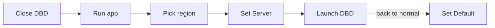
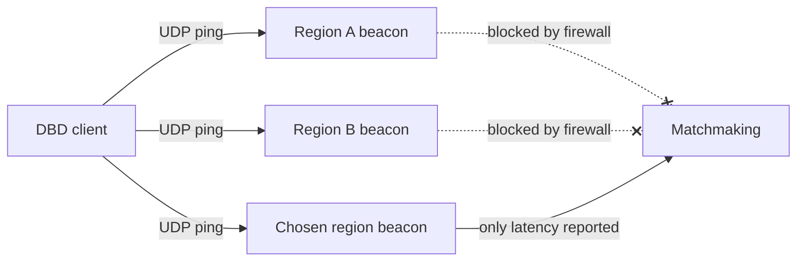

<p align="center">
  
</p>

<p align="center">
  <a href="https://github.com/y0f/dbd-region-changer/actions/workflows/ci.yml"></a>
  <a href="https://github.com/y0f/dbd-region-changer/stargazers"></a>
  <a href="https://github.com/y0f/dbd-region-changer/blob/main/go.mod"></a>
  <a href="LICENSE"></a>
  <a href="https://github.com/y0f/dbd-region-changer/releases/latest"></a>
  <a href="https://github.com/y0f/dbd-region-changer/blob/main/build/Dockerfile.linux-test"></a>
</p>

# Dead by Daylight Region Changer

**DBD Region Changer** is a free, open-source Dead by Daylight server region switcher for
**Windows and Linux**. Select a preferred AWS region, compare ping-beacon latency, and apply or
remove the region lock from one desktop window.

The app blocks the discovered GameLift ping beacon addresses of other regions with firewall rules.
On Windows the block applies only to the DBD executable; on Linux it is system-wide. No game files
are modified. Matchmaking remains controlled by DBD, so a particular server is not guaranteed.

> Close Dead by Daylight before changing regions. Launch the game after the change completes.

<p align="center">
  
</p>

## Download

Single binary, no installer, on the [releases](https://github.com/y0f/dbd-region-changer/releases/latest)
page. Each release from 1.0.1 on ships a `SHA256SUMS` file to verify the download.

## Windows and Linux support

| Platform | Download | Requirements |
|---|---|---|
| Windows x64 | `dbdregion-windows-amd64.exe` | Administrator access for Windows Firewall |
| Linux x86-64 | `dbdregion-linux-amd64` | glibc 2.34+, X11 or XWayland, OpenGL, iptables/ip6tables, and pkexec with a polkit authentication agent |

The tool runs natively on Linux. Dead by Daylight itself runs through Proton; Behaviour confirms
[continued Steam Deck and Proton support](https://steamcommunity.com/games/381210/announcements/detail/683011656593179781).

Both builds pass race tests and static analysis in [CI](https://github.com/y0f/dbd-region-changer/actions/workflows/ci.yml).
The Linux package also passes a graphical startup check. IPv4/IPv6 firewall creation, replacement,
and cleanup have been checked in an isolated Linux network namespace. In-game matchmaking has
not been tested with this release.

## Usage



- **Windows**: accept the admin prompt. The DBD exe is found in Steam, Epic Games and Xbox app
  installs; if it isn't, use `...` → *Set DBD path (firewall)* and pick `DeadByDaylight-*-Shipping.exe`.
- **Linux**: `pkexec` asks for your password when the firewall changes.
- **Set Default** removes the rules and restores normal matchmaking. Closing the app keeps the
  block (the next start shows it again), so click Set Default before you delete the app.
- Latency rows show endpoint measurements; TCP fallback is labeled as an estimate. These are not
  readings from the game, and matchmaking is still controlled by DBD.
- The beacon addresses rotate, so on Windows the block picks up
  new ones every minute while the app is open. On Linux that would need a password prompt each
  time, so there the block is renewed only when you click Set Server.

**Regions**: found at startup. The app lists every AWS region whose GameLift beacon answers, so the
list follows AWS. These are always listed: Hong Kong, Tokyo, Seoul, Mumbai, Singapore, Sydney,
Canada (Central), Frankfurt, Ireland, London, Sao Paulo, N. Virginia, Ohio, N. California, Oregon.

## Troubleshooting

Set Server needs admin rights to add firewall rules. If it errors: accept the elevation prompt,
make sure DBD is fully closed, and on Windows check that Controlled Folder Access or your antivirus
isn't blocking it.

## How it works



DBD runs on AWS GameLift. The client pings each region's beacon (`gamelift-ping.<region>.api.aws:7770`)
and reports the latencies to matchmaking. The app resolves those beacon addresses over
DNS-over-HTTPS and blocks all but your chosen region's: with Windows Firewall rules scoped to the DBD
exe, or with iptables rules on Linux that apply to every program on the machine. Nothing is
intercepted and no game files are touched. On Linux without iptables it falls back to a hosts-file
redirect.

## Building

Go 1.26.10+ and a C toolchain (the GUI uses cgo + OpenGL).

```powershell
# Windows (MinGW gcc on PATH). Embeds the icon and the admin manifest the app needs
# to write firewall rules, and builds without a console window.
./scripts/build-windows.ps1
```

```bash
# Linux (apt install gcc libgl1-mesa-dev xorg-dev libxkbcommon-dev)
./scripts/build-linux.sh
```

Both write to `dist/`. Tests: `bash scripts/test.sh` runs the pure-Go `internal/` tests without a
C toolchain but skips the GUI package `ui/`; the full suite, `ui/` included, needs gcc:
`CGO_ENABLED=1 go test -race ./...`. Linux build check from Windows (Docker): `./scripts/linux-test.ps1`.

The README screenshot is captured from the running app with live measurements:
`LIBGL_ALWAYS_SOFTWARE=1 xvfb-run -a go run ./scripts/preview docs/img/preview.png`.
The capture uses a temporary profile and leaves the firewall unchanged.

## License

[GPL-3.0](LICENSE)
