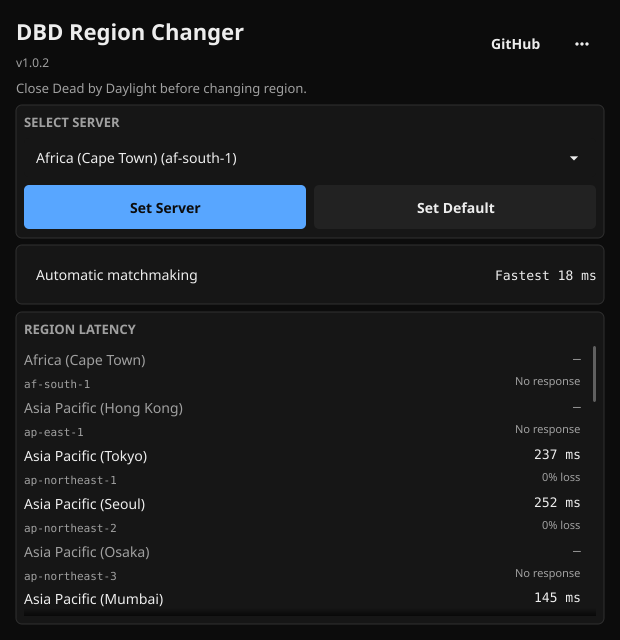
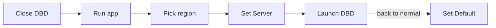
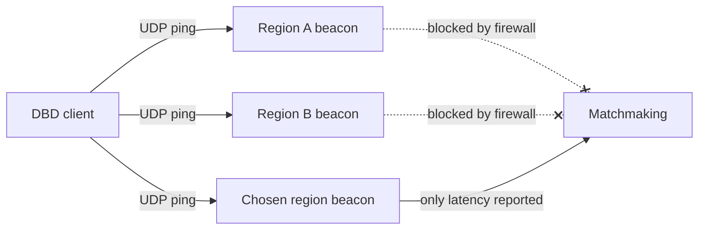

<p align="center">
  
</p>

<p align="center">
  <a href="https://github.com/y0f/dbd-region-changer/actions/workflows/ci.yml"></a>
  <a href="https://goreportcard.com/report/github.com/y0f/dbd-region-changer"></a>
  <a href="https://github.com/y0f/dbd-region-changer/blob/main/go.mod"></a>
  <a href="LICENSE"></a>
  <a href="https://github.com/y0f/dbd-region-changer/releases/latest"></a>
</p>

---

Small desktop app that locks Dead by Daylight to the AWS region you pick. It firewall-blocks the
ping beacons of every other region, scoped to the DBD executable, so the game can only measure and
match into the one you chose. Windows and Linux (Proton works).

> Close DBD before changing region and launch it after. Changing while it runs can flag Easy
> Anti-Cheat.

<p align="center">
  
</p>

## Download

Single binary, no installer, on the [releases](https://github.com/y0f/dbd-region-changer/releases/latest)
page. Each release ships a SHA256 checksum.

## Usage



- **Windows**: accept the admin prompt. The DBD path is found via Steam; otherwise use `...` → *Set DBD path*.
- **Linux**: `pkexec` asks for your password when the firewall changes.
- **Set Default** removes the rules and restores normal matchmaking.
- Ping bars show latency per region. On Windows the block auto-refreshes between matches.

**Regions**: Hong Kong, Tokyo, Seoul, Mumbai, Singapore, Sydney, Canada Central, Frankfurt,
Dublin, London, São Paulo, N. Virginia, Ohio, N. California, Oregon.

## Troubleshooting

Set Server needs admin rights to add firewall rules. If it errors: accept the elevation prompt,
make sure DBD is fully closed, and on Windows check that Controlled Folder Access or your antivirus
isn't blocking it.

## How it works



DBD runs on AWS GameLift. The client pings each region's beacon (`gamelift-ping.<region>.api.aws:7770`)
and reports the latencies to matchmaking. The app resolves those beacon IPs and blocks all but your
chosen region (Windows Firewall or iptables, scoped to the DBD exe). Nothing is intercepted and no
game files are touched. Without a firewall backend it falls back to a hosts-file redirect.

## Building

Go 1.26+ and a C toolchain (the GUI uses cgo + OpenGL).

```bash
# Windows (MinGW on PATH)
export PATH="/c/msys64/mingw64/bin:$PATH" CGO_ENABLED=1
go build -ldflags='-s -w' -trimpath -o dist/dbdregion.exe ./cmd/dbd

# Linux (apt install libgl1-mesa-dev xorg-dev libxkbcommon-dev)
CGO_ENABLED=1 go build -ldflags='-s -w' -trimpath -o dist/dbdregion ./cmd/dbd
```

Tests: `bash scripts/test.sh`. Linux build check from Windows (Docker): `./scripts/linux-test.ps1`.

## License

[GPL-3.0](LICENSE)
